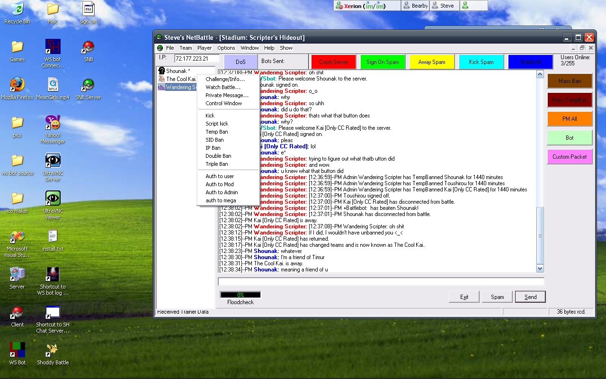
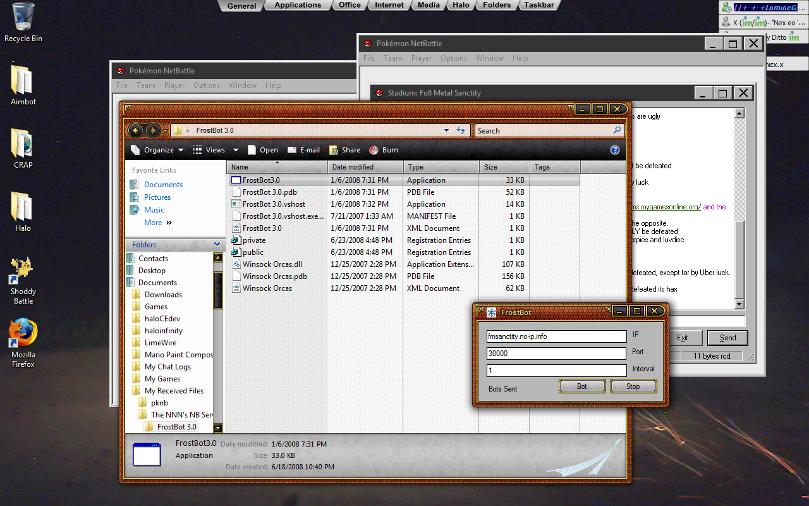

# A Preface

What you'll read below is a writeup I found when searching the web for various netbattle files, and it follows more or less with my own reccolection at the time. Before that, I'll include some details from my own memory of the events at the time.

Netbattle's final official version was 0.9.6. After release, TV's Ian, the game's creator seemed to disappear. 

During this time, a tool known as DS3, or DeathSchythe3, began to circulate among a few. They used this to run around to various servers, imposing demands, and crashing the servers who would not listen.

Steve, in response to attacks on his own server and himself in possestion of the source code of netbattle, created Steve's Netbattle. Steve's netbattle, like DS3, was a heavily weaponized version of netbattle used to abuse servers. A cruicial feature of this software however, was a fix to the main bug that allowed DS3 to crash servers. Suddenly, Steve's "Official Server", became the only server immune.

(I at one point obtained Steve's Netbattle, by tricking a friend of steve into a TeamViewer session and stealing it off his desktop. We later became friends lol. An issue though was Steve had implemented some kind of UN/PW auth to access Steve's netbattle. It took a few months, but we eventually found a copy of it: SNB Server. A simple app to register users. The security behind it all was really weak honestly. Anyways. Here's a screenshot of it.)

In addition to the immunity, Steve now distributed this software to a few trusted individuals, and he and those _also_ began running attacks on public servers.

To add a third layer, Steve had become the defacto host of the netbattle registry. He modified the registry program to add the ability to IP Ban players. Sweeping bans ensued to anyone who crossed him.

Myself and a group of others (Full Metal Kirby, RayquazaX, Masamune) wanted to understand and find a way to prevent these crashes. We discovered an application called Winsock Packet Editor, a network packet sniffer like wireshark, just a lot less intricate. We baited Steve into crashing our server while we were monitoring, and we had it. The crash packet.

It was simple: Netbattle player numbers internal to the server are 1-255. You can view this in the "Socket Viewer" window. If you craft a packet to send a private message to a userID of 0, the server crashes.

Another critical part of Winsock Packet Editor however, was the ability to intercept and modify packets before your system processed them. Using the captured crash packet, we were able to create a filter that would automatically block the crash packets, and could even respond with a kick. Our servers became safe.

During this time, I learned how to code in Visual Basic, studied the packet structure of netbattle using WPE, and created a third party client application that could connect to servers and perform attacks. I still have this application and it's full source code, but as it was my first ever app, it is coded like trash. It also could only connect to servers that did not use encryption.

The document below mentions a group called the 'NNN', or netbattle 3. The stated goal of this group was to bring down Steve and restore order to netbattle. I was a member of this group, and witnessed it from the inside. They commonly distributed a zip file called the server distruction folder, which mostly just contained tools like frostbot. The mentioned "Frost bots" below were very rudimantary Denial of Service applications written in visual basic. I actually still have the final version of frost bots, "Frosty Cannon". I'll include it in original files for postarity. 

After some time of rampaging, it seemed Steve matured. He became friends with the NNN and myself. He began to allow others to host the registry, myself included. The bans slowed down. 

With the advent of Netbattle: Supremecy, the hacking wars were over. Some stayed on mainline netbattle despite the new version, so Steve minted Netbattle 0.9.7. It fixed the infamous crash bug, changed the encryption algorithm, and forced encryption on all servers to prevent third party clients such as my own from appearing.

Anyway, here's that post. My username at the time was Wandering Scripter.

-------------------------------

This is a truth that must be revealed to any and all competitive battlers. Here are the facts, as people know them.

1. Pokemon Online is the best Pokemon Simulator to date.

2.The development "team" consists of one person, who is a VERY good programmer.

3. The main authority figures at this place apparently had a past with NetBattle. They say that the staff of NetBattle:Supremacy, the Diamond/Pearl version of NetBattle, "commenced immature spam attacks on their own program." They stick to this explanation very much.

Now, allow me to tell you the full story of NetBattle, from the days that TV'sIan and Smogon had already left, in 2007.

2007-2009
Steve, currently the head administrator of Pokemon Online, and Lord Meshadieme, a now-retired user of NetBattle, emailed TV'sIan, NetBattle's creator. They gained access to the server registry, which gave them control of what servers were allowed to appear on the registry, as well as host it. However, Steve began to use the registry to remove people he merely didn't like from the registry, not because they were doing anything wrong. Two users, Forte Raijectra, and SSJ3 Celebi, otherwise known as Cel, or Lumine, leader of PokemonInternetLand (PIL) RPG, a server that was scripted to run like an actual Pokemon game, took a stance against this abuse of power. They formed what was called the NNN. They began to engage in internet warfare with Steve. Another member of the NNN, Icy, created a program called a FrostBot. With the FrostBots on the NNN's side, they were able to take down Steve's server. However, he created a strong firewall to stop this.

Celebi began to hang around a server called Hell's Flames. Around the same time, another faction, known as the "Human Reformation League," (HRL) was formed by the users Rocket Admin Koga and Athrun Zala. Koga and Athrun phoned Masamune, and obtained the source code. They created another program called the DeathScythe3. This program, a modification of NetBattle 0.9.6, was created to take down servers by using the bugs in NetBattle's programming. He recruited some of them into the NNN. A user named DragonSage was the only person Cel knew with a dual core processor and 4 GB ram, therefore the only one able to effectively use the FrostBot to its full potential. With this, they broke through Steve's firewall and continued to keep his server down. However, another member of the NNN, Banter, betrayed Celebi, and backstabbed the NNN. What he really wanted, though, was to get Steve and Cel together.

The HRL, meantime, was attacking pretty much any server they wanted. However, they eventually found that working with the NNN to take down Steve would be a much better idea, since Steve still continued his use of the registry. They planned to shut him down permanently with a more powerful Deathscythe program, the DeathScythe4, and what they called "Operation Death Steve." While the NNN focused on Steve, the HRL just made everything miserable on the simulator. During this chaotic time, Athrun, through careful planning, pretended to betray Celebi and began to raid the NNN. Meanwhile, Koga relayed everything that occurred between Celebi and Athrun. Banter, in fact, was indeed working with Koga. Athrun pretended to team up with Steve to get rid of the NNN. They made a trade: In return for Steve giving Koga the source code and the registry, Koga gave Steve a DeathScythe4: in reality, a fake. It destroyed Steve's computer. Banter wasn't seen again for two years. Celebi went underground to begin reforming after this revolution. Celebi met a user named Lil-P. While Celebi, now known as Lumine, was busy reforming, became good friends with Koga, who became the new host of the registry. And all was well for a time.

The battle for the simulator, however, had sadly not finished. A mere 5 hours later, Steve, with the help of a user called Marik, reported the theft of the registry password to No-IP. Enraged that his power had been taken away, Steve used the parts of the DS4 that were included to make the file appear real to create "Steve's Net Battle"(SNB.) This was essentially a hack that allowed ban evasion, auto-admining, etc. SNB was distributed between Steve's circle of freinds, including a Brazilian user named "Nickelback." Eventually, SNB spread to Lumine himself. SNB required a login code, which only a select few knew. However, two other Brazilian users, Tom Jane and DarkWolf, friends of Koga, found ways around the login screen. Another program, called Winsock Packet Editor Pro, was also in heavy use around this time. This entirely unrelated program, as its website says, "is a packet sniffing/editing tool which is generally used to hack multiplayer games. WPE Pro allows modification of data at TCP level." Using WPE Pro, Lumine and another user, Full Metal Kirby, were able to counteract the effects of SNB and even the DeathScythe4. People began to find more and more ways to evade bans and crash servers. The Brazilian servers, in the meantime, became hostile as well and started crashing servers, Nickelback claiming that Steve and Cel were the "cancer of NetBattle." Steve then registry banned most of the country of Brazil by banning Brazil's general IP range.

Amidst the chaos, two rose up by the names of Wizard and Wandering Scripter. They obtained the source code of Netbattle from Steve and fixed the bugs which allowed the DeathScythes and SNB to operate. This effectively ended the chaos. At this time, Banter reappeared. He now succeeded in getting Celebi/Lumine and Steve to work together. Steve therefore entrusted Lumine with the registry, on the condition that he shared it with two of Steve's friends named "Haxon Jackson" and "Rixban." However, due to Wandering Scripter's grudge against Lil-P for previous annoyances, Lumine lost control of the registry a few months later. However, by this time, the NetBattle source code had been leaked. Lumine, Lil-P, and Full Metal Kirby each obtained the source code. FMK started work on NetBattle 9.8, which would have included early Diamond and Pearl work. Steve, in the meantime, had set up a new server, known as PMNB. The PMNB community became the server of choice. Full Metal Kirby was hard-pressed by Lil-P to finish 9.8. Because of this, Full Metal Kirby simply walked away, because he didn't want to deal with Lil-P's aggressive tendencies. Toward the end of 2008, a user by the name of Kioku, or Soviet Kioku, appeared on the scene. He was a user back in 2006, and he was very cunning from the start. However, it seemed NetBattle would never have Diamond and Pearl upgrades...

2009
And then a programmer by the name of Bayleef was found by Athrun. Athrun, Bayleef, and Koga are all irl friends. Koga took the guise of DJ Fury, and Bayleef created NetBattle Supremacy, which included Diamond and Pearl in its first release. PMNB became top server. The Brazilians were not amused. They began to hit the PMNB server with Denial of Service attacks. Kioku immediately proved his worth with what he called the Iron Curtain - essentially a firewall that blocked all Brazilian IPs from the registry with little to no exceptions. Kioku, happy about his achievements, gave Iron Curtain away to some people. Lumine created the 5th and final true incarnation of PIL RPG. All was well... And then another factor was added to the equation.

A female user named Lottiepop joined PMNB. She quickly befriended Steve, and simply because she claimed to be female, gained authority on PMNB. This angered the other authority figures. When Steve gave moderator powers to another female random named Moemii (who later disappeared) within one hour of her first appearance, it became apparent that Steve was merely trying to get a female to like him. It worked - Lottie ended up webcam chatting with Steve, as well as Kioku. Steve saw a little too much. It is still unknown if Kioku did as well. Kioku, out of annoyance for the way Steve and Lottie were acting, teamed up with Lil-P and destroyed PMNB on 7/11/2009. In August, Kioku created a server called Rhydon Colosseum, which became the dominant server. A month later, PMNB was regbanned for working with the Brazilians to DoS PIL. Kioku worked something out with the Brazilians and they became allied with PIL, kicking out Tom Jane and his friends. Celebi went into hiding for a time. Koga, weary of the drama of Netbattle, revealed himself to be DJ Fury and left. Celebi came out of hiding and PIL Normal was instated. Kioku, with his top server, also became corrupt with power. He was already arrogant before he had it. PMNB was also allowed to return, but they began to DoS servers for the top spot on the registry again. Therefore, Lumine, Bayleef, Athrun, and a persuaded Koga met in secret to discuss what to do about it. They called their plan the Final Solution. On January 20, 2010, everyone related to PMNB and Kioku were registry banned. The following pastebin is a record of the events. [COLOR="Red"]Warning: may contain offensive language.[/COLOR]

http://pastebin.com/6VfdYMqy

Yes, it was indeed a different time...

Anyway, I want to post a few more things that you may find interesting.
WARNING: May contain offensive language/etc. Knowing how these threads have been replied to, I wouldn't go there at work.

http://s1.zetaboards.com/netbattle/topic/2651208/
http://s1.zetaboards.com/netbattle/topic/2184220/
http://s1.zetaboards.com/netbattle/topic/2179969/
http://s1.zetaboards.com/netbattle/topic/2070807/

Now that I've done away with this miserable pile of secrets, I hope that you hear me out and if nothing else, know the horrible history that surrounds NetBattle, and by consequence Pokemon Online. I thank you for your time, and hope that you are able to believe my story with all the facts I have presented. My contact with my old friends in PIL is limited now... This is what I could gather...

And should PMNB find this, I dare you to disprove it. I dare you. This is the true history of NetBattle from the end of Smogon to the Final Solution. Thank you again